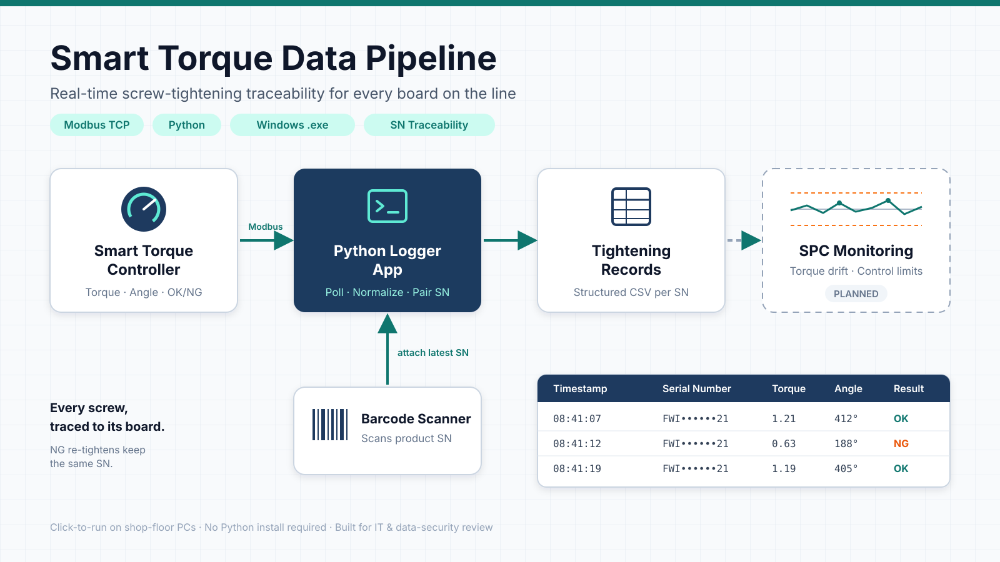

# Smart Torque Logger

**Real-time screw-tightening data collection with per-board serial-number traceability.**



A click-to-run Windows application that continuously reads tightening results from an ATX / ASAHI smart torque controller over **Modbus TCP**, links every screw record to the product serial number scanned at the station, and writes clean, MES-ready CSV files. It runs on shop-floor PCs with no Python install.

> This is a sanitized, portfolio version of an industrial project. All IPs, organization codes, serial-number formats and process specs have been replaced with demo values. The sample data is synthetic.

---

## Highlights

- **Continuous Modbus TCP acquisition.** Polls the controller's realtime and report registers, auto-reconnects with back-off, and survives network drops and controller restarts.
- **Stale-data protection.** Accepts a run only when the report changes *and* its angle matches the realtime register (re-read for up to ~4 s). Flags `DUPLICATE_SKIPPED` / `REPORT_STALE` rows instead of silently writing bad data.
- **Serial-number linking by sequence.** A background listener picks up barcode-scanner input (very fast keystrokes followed by Enter) without blocking other applications. The latest scanned SN is attached to each tightening record, and NG re-tightens keep the same SN.
- **Screw position and retry tracking.** Counts screw position 1–N per board and the attempt number per screw. Loosening (negative-angle) records stay in the raw file but are excluded from the API file.
- **No data loss when files are locked.** If a CSV is open in Excel, new rows are buffered in a local SQLite cache and flushed in order once the file is released, including after an app restart.
- **Unit normalization.** Raw torque integers are scaled to engineering units (configurable `torque_scale`).
- **Zero-install deployment.** Packaged as a single `.exe` with PyInstaller and configured through `config.ini`.

## Output

One pair of files per day:

| File | Content |
|---|---|
| `YYYY-MM-DD_api.csv` | 18-column MES screw-data format (SN, screw position, torque & limits, angle & limits, result, …) plus Pass/Fail, error code and attempt |
| `YYYY-MM-DD_raw.csv` | Every controller field selected in `headers1.txt`, plus SN-link diagnostics (`Scanned_SN`, `SN_Scan_Time`, `Screws_Since_Scan`, `SN_Check`) |

## Project structure

```
atx_logger_app.py        main application (Tkinter GUI + Modbus polling + SN listener + CSV writer)
fake_atx_controller.py   Modbus TCP simulator that replays a controller export CSV
atx_probe.py             connection troubleshooting (tries ports / unit IDs / framers)
headers1.txt/2.txt       which controller fields go into the raw CSV (tool 1 / tool 2)
config.example.ini       settings template
build_exe.bat            builds dist/ATX_Logger.exe on Windows
sample_data/             synthetic controller export for the demo
README_detailed.txt      full operator / deployment notes
```

## Quick demo (no hardware needed)

```bash
pip install -r requirements.txt
cp config.example.ini config.ini          # host = 127.0.0.1, port = 5020

# terminal 1: start the fake controller
python fake_atx_controller.py --csv sample_data/demo_controller_export.csv --port 5020

# terminal 2: start the logger
python atx_logger_app.py
```

CSV files appear in `./Data`. To also simulate the barcode scanner, add `--type-sn` to the simulator command and click into an empty text editor. The simulator then types each board's SN like a keyboard-mode scanner.

## Build the Windows executable

On a Windows PC with Python 3.10+, double-click `build_exe.bat`. Copy `dist/ATX_Logger.exe`, `headers1.txt` and `headers2.txt` to the production PC. `config.ini` is created on first run.

## Note on the keyboard listener

The SN listener only keeps input that looks like a barcode scan: characters arriving within `scanner_max_gap_ms` of each other, ending with Enter, and at least `scanner_min_length` long. Normal typing is ignored and never stored. Other applications still receive every keystroke unchanged. Get IT approval before deploying on a managed PC.

## Tech stack

Python · pymodbus · pynput · Tkinter · SQLite · PyInstaller
